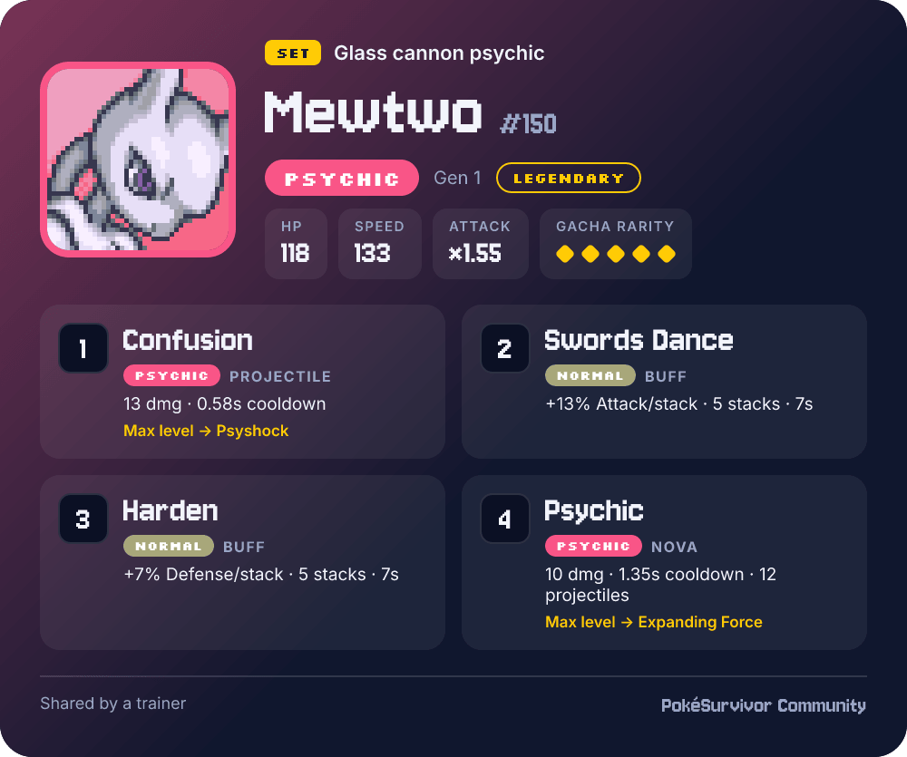
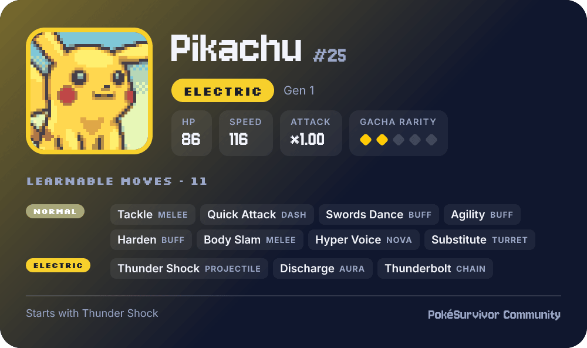
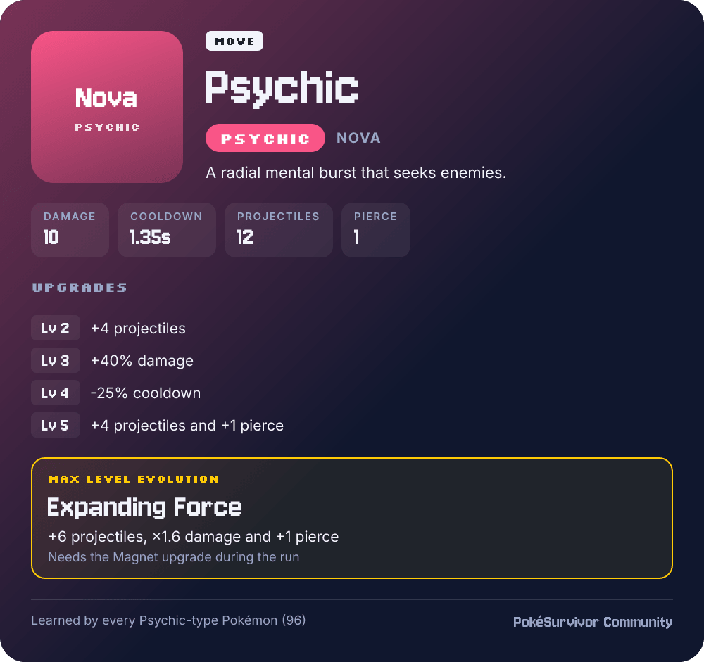

# PokéSurvivor Discord Bot

Discord bot for the unofficial PokéSurvivor Community server. It turns Pokémon, moves and sets from [PokéSurvivor](https://jpter78.itch.io/pokesurvivor) into image cards, using the game's own data.

> Fan-made and unofficial. Not affiliated with PokéSurvivor's developer, Nintendo, Game Freak or The Pokémon Company.



## Features

- `/pokemon name`: Pokémon card with in-game stats, gacha rarity and learnable moves.
- `/move name`: move card with behavior, stats, upgrades and max-level evolution.
- `/set pokemon move1 … move4 [title]`: share a set. Autocomplete only suggests moves the Pokémon can learn.
- Mentions in any message, up to 3 cards per message:
  - `[[Pikachu]]`
  - `[[Thunderbolt]]`
  - `[[Mewtwo: Confusion, Swords Dance, Harden, Psychic]]`
- Typos get a suggestion: "Did you mean **Pikachu**?"
- Datamine: after each game update, posts what changed in the game data (Pokémon, moves, items, upgrades, gacha, type chart) along with the new patch notes.

| Pokémon card | Move card |
|---|---|
|  |  |

## How it works

`scripts/build-data.js` downloads the game's data files from [JPTER78/pokesurvivor](https://github.com/JPTER78/pokesurvivor) (Pokédex, moves, type chart, items, upgrades, gacha, patch notes, English translations), runs them in a sandbox and writes `data/game.json`. Official English Pokémon names come from [PokéAPI](https://github.com/PokeAPI/pokeapi).

`scripts/datamine.js` compares `data/game.json` with the last announced version (`state/datamine.json`) and posts the differences on Discord. The first run only records the current version. To preview the post for any past update without posting:

```bash
node scripts/build-data.js --commit <parent-sha> --output cache/before.json
node scripts/build-data.js --commit <sha> --output cache/after.json
node scripts/datamine.js --before cache/before.json --after cache/after.json --dry-run
```

Cards are laid out with [satori](https://github.com/vercel/satori), rendered with [resvg](https://github.com/yisibl/resvg-js) and compressed with [sharp](https://github.com/lovell/sharp). Portraits are downloaded from PMD SpriteCollab and cached in `cache/`.

## Run locally

You need Node.js 22+, pnpm, and a Discord bot with the **Message Content** intent enabled.

```bash
pnpm install
pnpm run build-data
DISCORD_TOKEN=your-token GUILD_ID=your-server-id pnpm start
```

- Without `DISCORD_TOKEN`, the token is read from `~/.discord-token.txt`.
- Slash commands are registered on the `GUILD_ID` server.
- `pnpm run preview` regenerates the images in `docs/`.

## Deploy on the Google Cloud free tier

`deploy/` runs the bot on an `e2-micro` VM (Debian 12) with systemd.

1. Add an SSH host named `pokebot-vm` to `~/.ssh/config`.
2. On the VM, run `deploy/setup-vm.sh` once. It installs Node 22, adds swap and creates a `pokebot` user.
3. Put the token in `/opt/pokebot/.discord-token.txt`, owned by `pokebot` with mode `600`.
4. From your machine, run `bash deploy/deploy.sh` to upload and (re)start the bot.

A systemd timer refreshes the game data every 15 minutes, restarts the bot only when the data changed, then runs the datamine. The game's code runs as a separate `pokebot-data` user that can't read the Discord token.

## Credits

- [PokéSurvivor](https://github.com/JPTER78/pokesurvivor) by JPTER78. Its data is used under the PolyForm Noncommercial License 1.0.0. Required Notice: Copyright 2026 JPTER78 (https://github.com/JPTER78/pokesurvivor)
- Portraits: [PMD SpriteCollab](https://sprites.pmdcollab.org) contributors, CC BY-NC 4.0.
- Pokémon names: [PokéAPI](https://pokeapi.co).
- Fonts: Inter, Jersey 10 and Silkscreen, under the SIL Open Font License (see `assets/fonts`).
- Pokémon and all related names are trademarks of Nintendo, Game Freak and The Pokémon Company.

## License

[PolyForm Noncommercial 1.0.0](LICENSE.md).
